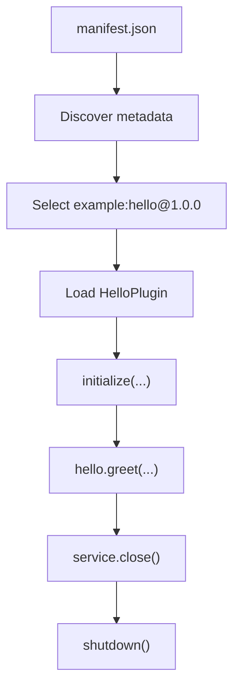

# Getting started

Build and run your first Invariant plugin from an empty directory.

You will create three files:

```text
hello_plugin/
├── manifest.json
├── plugin.py
└── run.py
```

and finish with:

```text
Hello, Invariant!
```

## Requirements

- Python 3.13 or newer
- Invariant Runtime installed in the active environment

From a source checkout, install it with:

```bash
python -m pip install .
```

## 1. Write the plugin

Create `hello_plugin/plugin.py`:

```python
from invariant.spec import BasePlugin


class HelloPlugin(BasePlugin):
    def initialize(self, **deps) -> None:
        pass

    def shutdown(self) -> None:
        pass

    def greet(self, name: str) -> str:
        return f"Hello, {name}!"
```

A plugin is ordinary Python code with a small lifecycle contract:

- `initialize(...)` is the point where the runtime makes the plugin usable;
- `shutdown()` releases plugin-owned resources;
- ordinary methods, such as `greet()`, define behavior for the host.

Plugin implementations should import author-facing contracts from `invariant.spec`.

## 2. Add the manifest

Create `hello_plugin/manifest.json`:

```json
{
  "manifest_version": 1,
  "id": "example:hello",
  "version": "1.0.0",
  "source": {
    "code_path": "plugin.py",
    "class_name": "HelloPlugin"
  }
}
```

For the recommended strict host path, these fields are enough:

- `manifest_version` selects the manifest contract;
- `id` is the stable plugin identity;
- `version` is the concrete plugin version;
- `source.code_path` points to the Python file;
- `source.class_name` names the plugin class.

Metadata, dependencies, timeouts, and Python isolation are optional until your plugin needs them.

## 3. Run it from a host

Create `hello_plugin/run.py`:

```python
from pathlib import Path

from invariant.api import PluginService


def main() -> None:
    plugin_dir = Path(__file__).resolve().parent
    service = PluginService.from_manifest_paths([plugin_dir])
    try:
        hello = service.get("example:hello")
        print(hello.greet("Invariant"))
    finally:
        service.close()


if __name__ == "__main__":
    main()
```

Run:

```bash
python hello_plugin/run.py
```

Expected output:

```text
Hello, Invariant!
```

That is the complete first-plugin path.

## What happened



`PluginService.from_manifest_paths(...)` keeps discovery, registry construction, and source loading behind the supported host API. Your application does not need to assemble those internal objects itself.

## Grow the plugin only when you need to

From here, a plugin can add:

- dependencies on other Invariant plugins or capabilities;
- policy-governed filesystem, HTTP, configuration, KV, or workspace access;
- isolated Python dependencies for packages that should not live in the host environment;
- richer metadata, maturity, and runtime timeout configuration.

None of those concepts are required for the first successful plugin.

## Next

- [Plugin authoring](guides/plugin-authoring.md) — lifecycle, dependencies, capabilities, and production guidance
- [Runtime model](concepts/runtime-model.md) — the small mental model behind the host API
- [Manifest v1](reference/manifest-v1.md) — fields, defaults, validation, and isolation metadata
- [Capabilities](reference/capabilities.md) — policy-governed access to host resources

The repository keeps this exact tutorial example in [`examples/hello_plugin`](https://github.com/kymuco/invariant-runtime/tree/main/examples/hello_plugin), and the documentation test suite checks that the tutorial code stays synchronized with those files.
