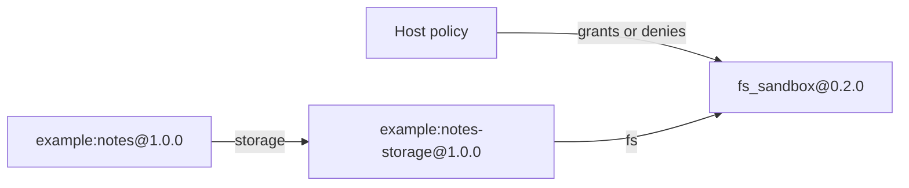

# Dependencies and capabilities

Use this guide after [Getting started](../getting-started.md) when one plugin needs another plugin and the graph also needs a host-governed resource.

The checked `capability_notes` example demonstrates both mechanisms without exposing runtime internals to plugin code.

## The graph



There are two different dependency edges:

- `example:notes` depends on another **plugin**;
- `example:notes-storage` depends on a **capability** owned by the runtime.

Both are declared in manifests and both arrive through `initialize(...)`.

## 1. Declare the plugin dependency

The notes plugin does not import the storage implementation. Its manifest names the exact dependency and the parameter that should receive it:

```json
{
  "dependencies": [
    {
      "id": "example:notes-storage@1.0.0",
      "param": "storage",
      "scope": "EXECUTION",
      "optional": false
    }
  ]
}
```

The plugin only accepts the resolved object:

```python
from invariant.spec import BasePlugin


class NotesPlugin(BasePlugin):
    def initialize(self, *, storage, **deps) -> None:
        self._storage = storage
```

The dependency is therefore a runtime relationship rather than a Python module import relationship.

## 2. Declare the capability dependency

The storage plugin needs filesystem access, but it does not construct an `FSAccess` object and does not import `invariant.exec`.

Its manifest requests the public capability contract by ID and version:

```json
{
  "dependencies": [
    {
      "id": "invariant:capability.fs_sandbox@0.2.0",
      "param": "fs",
      "scope": "EXECUTION",
      "optional": false
    }
  ]
}
```

The runtime resolves that reference through the current policy-gated capability view and injects the resulting handle:

```python
from invariant.spec import BasePlugin


class NotesStoragePlugin(BasePlugin):
    def initialize(self, *, fs, **deps) -> None:
        self._fs = fs
```

The plugin knows the behavior it needs from `fs`; the host controls whether that capability exists and what operations it permits.

## 3. Grant only the authority the execution needs

Host code stays on the public `invariant.api` surface:

```python
from invariant.api import EphemeralPolicy, PluginService, SandboxLimits

service = PluginService.from_manifest_paths(["examples/capability_notes"])
policy = EphemeralPolicy(
    limits=SandboxLimits(allow_fs_write=True),
)

try:
    with service.execution(policy=policy) as execution:
        notes = execution.get("example:notes")
        notes.save("governed dependency")
        print(notes.load())
finally:
    service.close()
```

Expected result:

```text
Notes: governed dependency
```

The sandbox root is execution-scoped. The plugin receives a rooted filesystem interface rather than an unrestricted path supplied by the plugin itself.

## 4. Deny the capability without changing plugin code

Change only the host policy:

```python
policy = EphemeralPolicy(
    limits=SandboxLimits(allow_fs=False),
)
```

Now `execution.get("example:notes")` cannot activate the graph because the required `fs_sandbox` capability is unavailable under the current policy.

The manifests and plugin implementations do not change. Authority is a host decision, separate from plugin identity and dependency declaration.

## What the runtime does

When the host requests `example:notes`, Invariant:

1. resolves `example:notes@1.0.0`;
2. resolves its `example:notes-storage@1.0.0` dependency;
3. resolves `fs_sandbox@0.2.0` through the execution's policy-gated capability view;
4. stages and initializes the dependency graph in dependency-first order;
5. commits runtime-owned plugin state only after the activation graph reaches READY;
6. shuts execution-owned plugins down in reverse order when the context closes.

Transactional activation protects runtime-owned activation state. It does **not** automatically roll back arbitrary external side effects performed later by plugin methods.

## Why not just import the other class?

For a small, static application, ordinary Python imports may be exactly the right solution. Invariant becomes useful when composition itself needs runtime contracts.

| Concern | Direct Python composition | Invariant runtime composition |
| --- | --- | --- |
| Dependency identity | Import/module path | Declared plugin ID |
| Plugin version | Usually package/environment choice | Concrete runtime reference |
| Dependency graph | Encoded in application code | Declared in manifests |
| Host resource authority | Application-specific | Policy-gated capability |
| Activation lifecycle | Application-defined | Runtime-owned transaction and shutdown |
| Capability denial | Custom wiring | Same graph, different host policy |

Invariant is not a replacement for Python imports. It is a boundary for systems where plugin identity, lifecycle, dependency resolution, and host authority must stay explicit.

## Run the checked example

From the repository root:

```bash
python examples/capability_notes/run.py
```

The exact source lives in [`examples/capability_notes`](https://github.com/kymuco/invariant-runtime/tree/main/examples/capability_notes) and is exercised by the core regression suite.

## Next

- [Plugin authoring](plugin-authoring.md) — lifecycle, scopes, versions, and production guidance
- [Runtime model](../concepts/runtime-model.md) — how service, plugin, manifest, and capability fit together
- [Manifest v1](../reference/manifest-v1.md) — exact dependency fields and defaults
- [Capabilities](../reference/capabilities.md) — built-in capability contracts and security semantics
- [Security](../security.md) — trust and isolation boundaries
