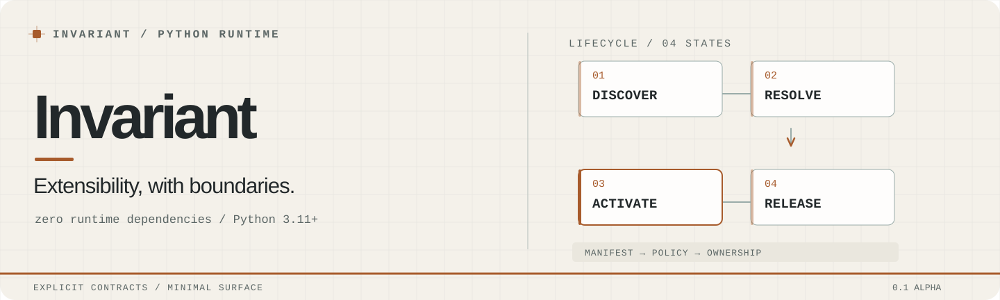

---
hide:
  - toc
---

<div class="iv-opening" markdown>

<span class="iv-kicker">A small Python runtime / 0.1 alpha</span>

<div class="iv-figure">
<picture>
  <source media="(prefers-color-scheme: dark)" srcset="assets/invariant-hero-dark.svg">
  
</picture>
</div>

# Plugins have lifetimes. Give them an owner.

`importlib` can load a module. It won't decide which plugin version you meant, wire declared dependencies, grant a capability according to policy, or clean up a half-activated plugin.

**Invariant takes responsibility for that part.** Your application still decides what its plugins do.

<div class="iv-actions">
<a class="iv-primary" href="getting-started/">Make a plugin →</a>
<a class="iv-secondary" href="reference/public-api/">Read the API</a>
</div>

</div>

## The boundary is the feature

<div class="iv-editorial" markdown>

<div class="iv-thesis" markdown>

### The application chooses. The runtime owns.

A host supplies discovery locations and policy. Plugins declare identity and requirements. Invariant handles runtime resolution and lifecycle without moving your application's behavior into the library.

</div>

<div class="iv-code-side" markdown>

```python
from invariant.api import PluginService

service = PluginService.from_manifest_paths(["plugins"])
try:
    plugin = service.get("example:hello")
    print(plugin.greet("Invariant"))
finally:
    service.close()
```

<small>One supported host facade. Ordinary Python plugin methods.</small>

</div>

</div>

## What is explicit

<div class="iv-ledger" markdown>

<div class="iv-ledger-row" markdown>

<span class="iv-ledger-key">Identity</span>

**A plugin is not just a file.** Manifests identify a source and concrete version. Discovery and version selection are deterministic.

[Manifest v1](reference/manifest-v1.md)

</div>

<div class="iv-ledger-row" markdown>

<span class="iv-ledger-key">Authority</span>

**A requirement is not a grant.** Capability handles are supplied only when host policy permits them.

[Capabilities](reference/capabilities.md)

</div>

<div class="iv-ledger-row" markdown>

<span class="iv-ledger-key">Lifetime</span>

**Activation creates obligations.** The runtime manages its own activation, rollback and shutdown state within documented limits.

[Runtime model](concepts/runtime-model.md)

</div>

</div>

## Zero mandatory runtime dependencies

Invariant's production package uses the Python standard library. There is no mandatory dependency stack to install alongside it; individual plugins may have third-party dependencies of their own.

The supported imports are intentionally narrow: hosts use `invariant.api`, plugin authors use `invariant.spec`. The implementation layers can evolve during 0.x without silently expanding the public contract.

<div class="iv-note" markdown>

**A policy boundary is not a hostile-code sandbox.** In-process plugins are trusted Python. Worker processes alone do not isolate hostile code, and rollback cannot undo arbitrary external effects. [Read the security model](security.md).

</div>

## Continue from here

<div class="iv-route-list" markdown>

[Build a plugin in five minutes](getting-started.md) · [Understand the runtime](concepts/runtime-model.md) · [Embed the public API](reference/public-api.md) · [Read the exact manifest contract](reference/manifest-v1.md) · [Contribute](project/contributing.md) · [Project status](project/status.md)

</div>

<small class="iv-colophon">Invariant Runtime / Python 3.11+ / Apache-2.0 / pre-1.0 compatibility</small>
